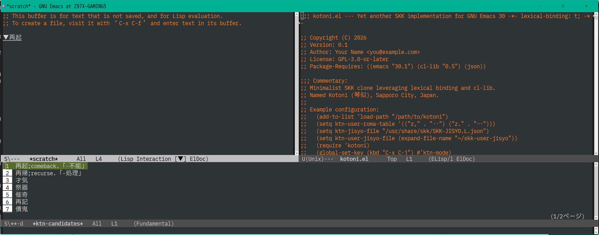

# kotoni.el --- Yet another SKK implementation for GNU Emacs 30

Kotoni (琴似) は、Emacs 30 以上で動く、最小限の機能に限った SKK クローン（マイナーモード）です。

名称は札幌市の地名「琴似」（ことに）に由来しています。

https://ja.wikipedia.org/wiki/%E7%90%B4%E4%BC%BC

---

## スクリーンショット



---

## 特長

- DDSKK と比べ、まったく機能は足りてませんが、ひとつの .el ファイルに収まっており、コードの見通しは良い（はず）です。
- Overlay 表示: ▽見出し語の表示は Overlay です。
- 個人辞書: 確定した単語の頻度を自動学習。次の変換時に優先表示します。`~/.jisyo.json` に自動保存。
- 共有辞書: 従前の skk 辞書に加え、json 辞書も利用可。

---

## 動作要件

- **Emacs**: 30.1 以降
- **依存ライブラリ**: `cl-lib` (0.5 以降), `json`

---

## 辞書データの変換 (`skk2json.el`)

従来のテキスト形式の SKK 辞書（`SKK-JISYO.L` など）を JSON 形式に変換するためのユーティリティ `skk2json.el` が含まれています。

### 使い方
1. Emacs で `skk2json.el` を開き (`C-x C-f skk2json.el`)、そのままバッファを評価します (`M-x eval-buffer`)。
2. コマンドを実行し (`M-x skk2json`)、入力元の辞書ファイルと出力先の JSON ファイルを指定します。
3. 生成された JSON ファイルを `ktn-jisyo-file` に指定してください。

### JSON 辞書に変換するメリット
- **検索パフォーマンスの向上**: ファイルを Emacs のメモリ上（ハッシュテーブル）へ一括ロードするため、見出し語の検索が瞬時（O(1)）に行われ、入力時のレスポンスが高速化します。
- **拡張性とメンテナンス性**: 単語と注釈がオブジェクトとして構造化されるため、将来的なメタデータの追加や他ツールとのデータ連携が容易になります。
  + 品詞情報や登録日時などの情報を持たせることができるようになる
  + 他のツール等でもSKK辞書データを再利用・処理・編集しやすくなる

---

## インストールと設定

`kotoni.el` をロードパスの通ったディレクトリに配置し、`init.el` に以下を設定します。

```elisp
(add-to-list 'load-path "/path/to/kotoni")

;; 辞書ファイルや個人統計ファイルのパス設定（任意）
(setq ktn-jisyo-file (expand-file-name "~/.emacs.d/SKK-JISYO.L.json")
      ktn-stats-file (expand-file-name "~/.jisyo.json"))

;; ユーザー独自のローマ字・記号変換ルールを追加（任意）
(setq ktn-user-roma-table '(("z," . "‥") ("z." . "…")))

(require 'kotoni)
(global-set-key (kbd "C-x C-j") #'ktn-mode) ; C-x C-j で ktn-mode をトグル
```

---

## 操作方法

`M-x ktn-mode` または設定したキー（例: `C-x C-j`）でマイナーモードを有効化します。

### 基本的な入力・変換
| 操作・入力 | 挙動 |
| :--- | :--- |
| **小文字入力** (`kanji`) | そのまま「かんじ」と通常入力されます。 |
| **大文字入力** (例: `K` → `kanji`) | **▽ モード（見出し語入力）開始**。 |
| `SPC` (スペース) | **変換開始（▼ モード）**。候補を順送りします。 |
| `C-j` | **確定**。現在の選択候補または入力文字列をバッファに挿入します。 |
| `RET` / `C-m` | **確定＋改行**。 |
| `C-g` | **キャンセル**（変換中なら▽モードへ戻り、▽モード中ならキャンセル）。 |
| `C-h` / `DEL` | **バックスペース**（入力文字を1文字ずつ削除）。 |
| `q` | **カタカナ変換確定**（▽モード時）。 |

### TAB 補完機能
| 操作・入力 | 挙動 |
| :--- | :--- |
| `TAB` / `<tab>` | ▽モード時に前方一致する見出し語を**順方向**に補完・候補一覧表示します。 |
| `<backtab>` / `S-TAB` | ▽モード時に補完候補を**逆方向**に巡回します。 |

### 変換中の候補選択
| 操作・入力 | 挙動 |
| :--- | :--- |
| 数字キー (`1`〜`7`) | 画面上の対応するインデックスの候補を**一発確定**します。 |
| `SPC` | 次の候補へ進みます。候補を出し切ると辞書登録プロンプトへ移行します。 |
| `x` / `X` | 前の候補へ戻ります（最初の候補で押すと▽モードに戻ります）。 |
| `<next>` (PageDown) / `<prior>` (PageUp) | 候補のページを次/前へ送ります。 |

### 辞書登録
辞書にヒットしない状態で `SPC` を押すか候補を出し切ると、ミニバッファで新しい単語の登録プロンプトが起動します。
- `C-c C-c`: 入力した単語を登録して終了します。

---

## カスタマイズ（ユーザ変数・フェイス）

`M-x customize-group RET ktn RET` から、各種パスや見た目（フェイス）をカスタマイズできます。

### 主要なカスタマイズ変数
- **`ktn-jisyo-file`**: システム辞書（Text形式 または JSON形式）のファイルパス。
- **`ktn-stats-file`**: ユーザーの変換統計・学習データを保存する JSON ファイルのパス（デフォルト: `~/.jisyo.json`）。
- **`ktn-user-roma-table`**: ユーザー独自のローマ字・記号変換ルールのリスト。

### フェイスのカスタマイズ例
```elisp
;; ▽ / ▼ モード中のインライン表示の見た目
(custom-set-faces
 '(ktn-headword-face ((t (:background "#3a3a3a" :underline t)))))

;; 選択中候補のハイライトフェイス
(custom-set-faces
 '(ktn-selected-face ((t (:background "darkslateblue" :foreground "white")))))
```

---

## ライセンス

[GPL-3.0-or-later](LICENSE)