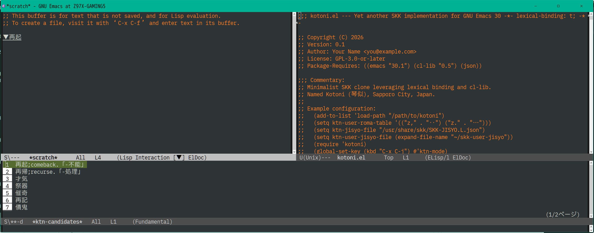

# kotoni.el --- Yet another SKK implementation for GNU Emacs 30

Kotoni (琴似) は、Emacs 30 以上で動く、最小限の機能に限った SKK クローン（マイナーモード）です。

名称は札幌市の地名「琴似」（ことに）に由来しています。

https://ja.wikipedia.org/wiki/%E7%90%B4%E4%BC%BC

---

## スクリーンショット



---

## 特長

- 爆速:
  * 共有辞書には Trie 風の json 辞書を導入。結果として、補完や候補の表示で「引っ掛かり」（wait）がまったく生じません。

- コードの見通しが良い（はず）:
  * 機能拡張や保守が容易。E2Eテストを同梱。

- 自動 off 機能:
  * プログラミング系メジャーモードにおいて、カーソル（ポイント）がコメント or 文字列の「外」に出たら、自動で off
  * これを実現するメジャーモード `kotoni-auto.el` を同梱。

- そのほか:
  * 機能不足: DDSKK と比べ、まったく足りてません。
  * Overlay 表示: 見出し語（▽みだしご）の表示は Overlay を活用
  * 個人辞書: 確定した単語の回数を自動学習（何に活用できるのやら...）

---

## 動作要件

- **Emacs**: 30.1 以降
- **依存ライブラリ**: `cl-lib`, `json`

---

## 辞書データの変換 (`skk2triejson.el`)

従来の「行指向テキスト形式」の SKK 辞書（`SKK-JISYO.L` など）を kotoni 辞書（Trie-JSON）へ変換するためのユーティリティ

### 使い方
1. Emacs で `skk2triejson.el` を開き (`C-x C-f skk2triejson.el`)、そのままバッファ全体を評価します (`M-x eval-buffer`)。
2. scratch バッファで次の式を評価します。

```elisp
== *scratch* ==
(let* ((root (expand-file-name "~/jisyo"))
       (files '("SKK-JISYO.L"
                "SKK-JISYO.geo"
                "SKK-JISYO.jinmei"
                "SKK-JISYO.law"
                "SKK-JISYO.propernoun"
                "SKK-JISYO.station"))
       (skk-files (mapcar (lambda (file)
                            (expand-file-name file root)) files)))
  (skk2json-merge-skk-dicts-to-json skk-files (expand-file-name "SKK-JISYO.trie.json" root)))
== *scratch* ==
```

3. 生成された JSON ファイルを `ktn-jisyo-file` に指定してください。

---

## インストールと設定

各ファイル `kotoni*.el` をロードパスの通ったディレクトリに配置し、以下の内容を `init.el` に設定します。

```elisp
(add-to-list 'load-path "/path/to/kotoni")

;; 辞書ファイルや個人統計ファイルのパス設定（任意）
(setq ktn-jisyo-file (expand-file-name ".emacs.d/SKK-JISYO.trie.json" "~/")
      ktn-stats-file (expand-file-name ".jisyo.json" "~/"))

;; ユーザー独自のローマ字・記号変換ルールを追加（任意）
;; (setq ktn-user-roma-table '(("z," . "‥") ("z." . "…")))

(require 'kotoni)
(global-set-key (kbd "C-x C-j") #'ktn-mode) ; C-x C-j で ktn-mode をトグル

;; (require 'kotoni-auto) ; 任意
;; (add-hook 'prog-mode-hook #'kotoni-auto-mode)
```

---

## 操作方法

`M-x ktn-mode` または設定したキー（例: `C-x C-j`）でマイナーモードを有効化します。

 - skk で言う「かなモード」のみです。カナモード、全英モード、アスキーモードはありません。


### 基本的な入力・変換
| 操作・入力                      | 挙動                                                                   |
| :------------------------------ | :--------------------------------------------------------------------- |
| **小文字入力** (`kanji`)        | そのまま「かんじ」と通常入力されます。                                 |
| **大文字入力** (`K` → `kanji`) | **▽ モード（見出し語入力）開始**。                                    |
| `SPC` (スペース)                | **変換開始（▼ モード）**。候補を順送りします。                        |
| `C-j`                           | **確定**。現在の選択候補または入力文字列をバッファに挿入します。       |
| `RET` / `C-m`                   | **確定＋改行**。                                                       |
| `C-g`                           | **キャンセル**（変換中なら▽モードへ戻り、▽モード中ならキャンセル）。 |
| `C-h` / `DEL`                   | **バックスペース**（入力文字を1文字ずつ削除）。                        |
| `q`                             | **カタカナ変換確定**（▽モード時）。                                   |

### 送り仮名が有る場合

- `U` `g` `o` **`K`** `u`
  - 動く

- `H` `a` `s` `i` **`T`** `t` `a`
  - 走った

### 見出し語の補完機能
| 操作・入力            | 挙動                                                                     |
| :-------------------- | :----------------------------------------------------------------------- |
| `TAB` / `<tab>`       | ▽モード時に前方一致する見出し語を**順方向**に補完・候補一覧表示します。 |
| `<backtab>` / `S-TAB` | ▽モード時に補完候補を**逆方向**に巡回します。                           |
| `<meta>-SPC`      | 補完し、変換します（TAB 押して, SPC 押すよりも気軽な気がします）                 |

### 変換中の候補選択
| 操作・入力                               | 挙動 |
| :--------------------------------------- | :------------------------------------------------------------------- |
| 数字キー (`1`〜`7`)                      | 画面上の対応するインデックスの候補を**一発確定**します。             |
| `SPC`                                    | 次の候補へ進みます。候補を出し切ると辞書登録プロンプトへ移行します。 |
| `x` / `X`                                | 前の候補へ戻ります（最初の候補で押すと▽モードに戻ります）。         |
| `<next>` (PageDown) / `<prior>` (PageUp) | 候補のページを次/前へ送ります。                                      |

### 辞書登録
辞書にヒットしない状態で `SPC` を押すか候補を出し切ると、ミニバッファで新しい単語の登録プロンプトが起動します。
- `C-c C-c`: 入力した単語を登録して終了します。

---

## カスタマイズ（ユーザ変数・フェイス）

`M-x customize-group RET ktn RET` から、各種パスや見た目（フェイス）をカスタマイズできます。

### 主要なカスタマイズ変数
- **`ktn-jisyo-file`**: システム辞書（Trie-json形式）のファイルパス
- **`ktn-stats-file`**: ユーザーの変換統計・学習データを保存する JSON ファイルのパス（デフォルト: `~/.jisyo.json`）
- **`ktn-user-roma-table`**: ユーザー独自のローマ字・記号変換ルールのリスト
- **`ktn-newline-on-enter`**: デフォルト値は t。nil にすると、▽や▼において、選択した候補を `ENTER` で確定する際に改行を伴ないません

### フェイスのカスタマイズ例
```elisp
;; ▽ / ▼ モード中のインライン表示の見た目
(custom-set-faces
 '(ktn-headword-face ((t (:background "#3a3a3a" :underline t)))))

;; 選択中候補のハイライトフェイス
(custom-set-faces
 '(ktn-selected-face ((t (:background "darkslateblue" :foreground "white")))))
```

---

## ライセンス

[GPL-3.0-or-later](LICENSE)
